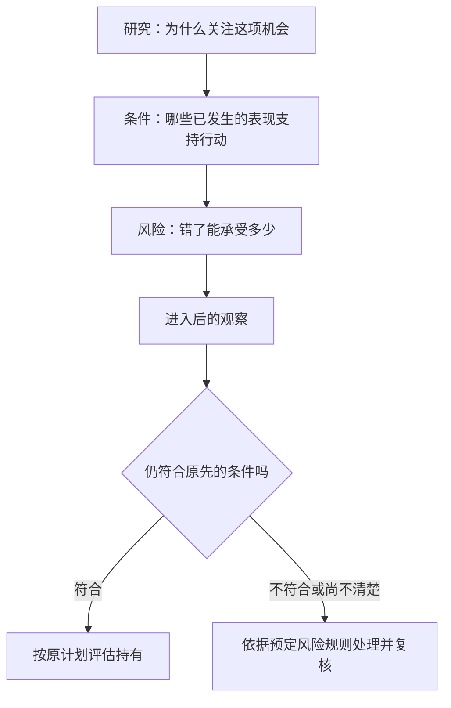

# 04 · 第二章续讲：正常回撤，正常在哪里

> 学习顺序：**04 / 10**（本项目编号，含导论；作者课号另记）。
> [原视频：炒股不炒主升浪，打一家居用品](https://www.bilibili.com/video/BV12A41147mW) · 奇衡DK-CAPITAL · 2020-04-25 · 25:57  
> 已核为上一课预告的“不被套（2）”；作者 04:14 左右明确说第二章分两课，本片是第二讲。  
> [时间轴学习稿及核验记录](../transcripts/BV12A41147mW.md) · [系列学习地图](../)

本课最值得学会的是：**同样叫缩量回调，放在不同阶段、持续不同时间，不能自动得到相同的持仓结论。** 奇衡用相似图形制造一个难题，再补回原先容易被忽略的条件。这比摘出“持有盈利头寸”更有教学价值。

2026-10-10 按新版重做。配套文字稿按 11 个步骤回看，本笔记按问题提炼；三张原始截图保留误读、练习与解释的先后关系。

## 一 先做双黄框题，再听解释

### 01 · 先看容易误读的位置 {#misread-zone-frame}

**课堂位置：19:41—21:13。** 作者先把书中上涨后缩量回撤的描述，放到一张匿名鞋企图上。只看“先放量、后缩量”，很容易觉得红框里的长期整理也适用。

*原视频 [20:44](https://www.bilibili.com/video/BV12A41147mW?t=1244)。红框和箭头来自课件。这是作者展示的误读位置，并非他认可的正常回撤区域；个股身份未核，不据此补公司名称。*

### 02 · 两个黄框，用同一个理由能解释吗？ {#two-boxes-frame}

**课堂题面：21:14—22:40。** 接着换成另一只匿名股票。两处黄框附近都有放量后的缩量回调，作者追问：如果坚持一致的操作方式，是不是两处都该继续承受回调？

*原视频 [21:27](https://www.bilibili.com/video/BV12A41147mW?t=1287)。这是另一只股票，不能与上一图拼接为同一家公司的连续走势。图中已有后续行情，练习时先遮住右侧，避免用结果倒推理由。*

先写出自己的判断依据：两处的共同特征究竟够不够？还缺的是位置、持续时间，还是回落后的表现？这里先不要求给出买卖答案。

::: details 03 · 展开作者解释：回到主升阶段，再看恢复速度

### 返回第一张图 {#recovery-stage-frame}

*原视频 [23:25](https://www.bilibili.com/video/BV12A41147mW?t=1405)。这次回到第一张鞋企图，红框从长期整理移向快速上涨阶段。画面证明作者所指的区域；短暂回落后较快恢复的条件还需结合口述与 24:02 总结页阅读。*

**作者的解释：** 22:41 后切回鞋企图，将正常回撤定位到主升阶段较短的回落，而不是前面长时间整理的区域。随后补上较快收复和新高；24:02 总结页明确包含“一两天内创新高”。因此同样的缩量现象，离开阶段与时间便不足以支撑他的结论。

**整理者理解：** 这道题揭示了一个常见问题：读书时记住了醒目的形态，却忘记了段落在描述什么阶段。遇到相似画面便以为找到了依据，错误可能出在只记了条件的一部分。

**再进一步：** 回落当时还不知道随后能否快速恢复。课程给出了观察条件，却没有在这里给出完整的实时识别和成交退出方案；不能把历史图上的完成形态直接当成当时已知信号，也不能自行补成“两天不创新高就机械卖出”。

:::

可用一项阅读练习检查自己：每摘一条方法，旁边另写“它在什么状态下说、预计多久出现什么反馈、哪些情况不属于它”。这些是整理者建议的笔记字段，并非作者提供的完整表格。

## 二 接住上一课的问题：允许波动，不等于允许无限等待

**课程依据：02:22—02:46、19:41—24:46。** 上一课留下的问题是：既然偏好从开始就表现良好的头寸，途中出现回落怎么办？本课没有把“盈利”解释成价格每一刻都不能下跌，而是讨论一轮上涨中哪些回撤符合作者理解的正常动作。

按本片的论证，至少需要同时看这些信息：

| 观察维度 | 本片给出的限定 | 不能省掉它的原因 |
| --- | --- | --- |
| 所处阶段 | 作者指向已经展开的主升过程 | 刚突破后的长期横盘、上涨后的不同阶段，不能只凭外观混为一谈 |
| 量价关系 | 上涨时量能扩张，回落时量能相对收缩 | 单独一个缩量现象，没有说明后续是否恢复强势 |
| 持续时间 | 作者在总结页明确提到一两天 | 时间拖长以后，原先关于快速恢复的预期可能已不满足 |
| 后续表现 | 较快收复回撤并进入新高区域 | 只看回撤当下，就把未来恢复当成必然，是跳过了尚未出现的证据 |

这是对课堂描述的整理，不是本项目验证过的交易规则。“一两天”已核课件，但不能任意换算成所有市场、周期和标的的统一退出时限。

**对系列 Q7 的回答：** 正常的价格回落可以存在；它应与作者所讨论的行情阶段、相对量能和恢复速度相容。但本课仍没有完整回答：入场后允许浮亏多少、如何处理跳空、到期未恢复时在哪一笔成交退出。因此 Q7 是获得实质深化，而非彻底解决。

## 三 一致性是让方法可检验，不是永远不许更新

**课程依据：21:30—22:08。** 作者反对遇到一个案例用一种说法，遇到另一个案例便临时变通；否则无法确认所总结做法的胜率。

**整理者理解：** 如果买前没有明确条件，买后可以不断改解释，任何结果都能被包装为原先判断正确。相比追求每次都说对，更有学习价值的是让别人也能理解自己当时依据什么、何时承认条件没有出现。

但一致性也需要明确范围。它不意味着对不同交易制度、不同周期一律用同一个参数，更不意味着新证据出现后禁止修订方法。可以事先规定哪些环境用哪些规则，并把后来的修改留下版本记录；不能为挽救单次结果，事后悄悄重写条件。

**研究边界：** 固定规则有助于计数，却不自动使样本具有代表性，更不保证未来胜率稳定。作者的这一段是检验意识，尚未构成完整统计验证。

## 四 为什么“不敢赚”与“敢亏”会出现在同一个人身上

**课程依据：12:59—17:37；约 16:22 核课件。** 作者讨论盈利时急于退出、亏损时反而长期持有的反差。他还承认自己偶尔也有过解套便走、随后错过上涨的经历，没有把这一问题只归给别人。

他进一步指出，缺少相对稳定的判断参照，会使人不知道何时该行动、何时该停。年线是他在本例中采用的参照，但他特意区分“交易技术上的问题”与狭义技术分析。

**整理者理解：** 若唯一的参照是自己的买入价，回本可能比趋势变化更能支配情绪：亏损时等待恢复原状，稍有盈利又急于结束不适。学习可以先检查自己是否把“我终于不亏了”误当成“此刻已经有充分退出理由”。反过来，也不能因为担心卖飞就取消退出条件。

**外部研究补充：** Odean 对一家折扣券商一万个账户的交易记录研究，观察到投资者倾向于实现盈利而继续持有亏损，这与本课所谈行为有相通之处。研究支持该行为值得重视，并不验证奇衡具体的年线或主升浪方法。[Odean：Are Investors Reluctant to Realize Their Losses?](https://faculty.haas.berkeley.edu/odean/papers/disposition/disposition.html)

**感悟：** 把问题只归为“我心态差”，会让改进停在自责。若能找出决定当时没有清楚参照，至少可以尝试补充判断程序。与此同时，也不能把心理因素全部归结为一条均线就能解决。

## 五 入场理由和入场时机，需要分别交代

**课程依据：17:38—19:40；约 18:50 核课件。** 作者把入场分为充分理由与一定形式：研究说明为何关注某一方向，形式准则帮助确定何时建立头寸。他将它与保护账户、情况不对便退出放在同一段论述中。

以下是整理者将本课与前两课连接后的学习框架，不是作者公布的完整系统：

**课程推进：** 正课开篇将观点和下单分开；上一课强调等待；本片再加上进入以后怎样观察表现。这样，所谓“不被套”逐渐从一句买入原则，变成入场与持仓管理之间的联系。

**仍缺的信息：** 作者没有列出可直接执行的仓位公式、全部入场形态、量能阈值或统一退出价。年线也未说明精确计算与复权设置。片中关于除权和前复权的提醒，至少说明绝对股价应放在相同数据口径下比较；这不证明价格水平从此完全没有用途。

## 六 “研究股民”没有取消研究公司

**课程依据：10:37—12:58。** 作者先讨论作手对产业链、商业模式、财务报表、管理层和股东的理解，再谈其他参与者如何认识这些事实，以及这种认识是否存在偏差。

如果只摘出赢家研究股民，前面的门槛就消失了。更完整的课堂关系是：理解对象，再研究市场对它的理解，两层之间可能有差异。

**整理者边界：** 作者对作手、庄家和散户的表述具有教学上的概括性，不是所有市场参与者的定义，更不是具体公司的违法行为证据。鞋企案例中涉及减持、定增及炒作的口述，本次没有核实公司身份和公告，故不补名、不据此作事实指控。

### 原油宝例子的核验边界

14:13—15:00，作者用当时原油宝事件提醒：损失可能早已在积累，产品规则也需要事先理解。

中国银行当时说明，原油宝为境内个人提供挂钩境外原油期货的交易服务，并讨论了挂钩 WTI 五月合约负结算价格的情况。这可核实产品和事件背景，不能据此证明每位客户为何持有或是否曾有条件退出。[中国银行：关于“原油宝”产品情况的说明（2020-04-24）](https://wap.boc.cn/bif/bi2/202004/t20200424_17793210.html)

本课是事件发生后的评论；具体损失原因与责任不能简化为参与者“不肯止损”。教学上可以研究自身决策，事实判断仍需产品规则、交易时段和完整记录。

## 七 生活段落值得保留，但不应被交易口号吞掉

**课程依据：02:48—04:04、04:47—10:36。** 作者谈顺境时做储备、面对不确定性，以及家庭经历让自己重新体会准备不足的代价。他明确说，亲情中的坚持与交易上的止损理念并不相同；回到交易时，又要求先设定自己愿意承担的损失，在可承受范围内尝试。

这段的价值不仅是给技术内容作引子。它让人看到一个讲纪律的人，也会在不同生活领域面对不同目标：有些决定追求风险收益效率，有些决定表达责任和情感，不能机械共用一种衡量方式。

**整理者感悟：** 从交易中学到一种有效原则，并不意味着它可以不加区分地管理全部人生。真正值得迁移的是事前了解规则、承认知识不足和为重要事情做准备；具体价值选择仍要回到情境。本笔记不评价作者家庭医疗决定，也不将其转化为医疗建议。

另一层值得体会的是，专业熟练并不消除人在陌生领域的无助。这可以促使学习者少用“别人怎么连这都不懂”解释他人的恐慌，转而问：当事人究竟缺少哪些规则和准备？

## 复习与后续追踪

以下为整理者自拟练习：

1. 两段走势都缩量回调，还需要知道哪三类信息，才能讨论是否符合作者的正常回撤描述？回看 19:41—24:15。
2. 把“我看好这家公司”分别改写成研究理由、可观察入场条件和判断失效条件；本课没有提供的数值留空，不能臆造。
3. 在一段已知后续走势的图中，遮住右侧再作判断，检查自己是否把后来创新高当成当时已知事实。
4. 一次退出是因为趋势条件改变，还是因为刚好回本？两种动机是否被混在同一个理由里？回看 15:08—17:37。

**系列问题更新：** Q7 已补上主升阶段、相对缩量与较快恢复的限定；Q5 增加进入后的验证，但实时认定主升阶段和退出执行仍待后课。Q1 关于“最”字的悬念仍未回答。新增问题是：**如何在当时识别主升阶段，而不是行情结束后圈出最陡的一段？**

下一章由作者在 04:19—04:26 明确预告为追随领头羊，片尾再次预告怎样赚大钱。不把本片的结论扩大为所有交易方法必须相同。

后续核验更新（2026-10-04）：预告已对应[《股市领头羊烹调指南》](BV1KA411t7p3.md)，该课讨论观察对象与持仓对象的区别，并保留与本课研究要求之间的未解问题。

## 资料与校订说明

::: details 展开本次重做的证据与边界

- 2026-10-10：重新读取完整视频的本地自动转写，按课内步骤重做配套文字稿，并补入 20:44、21:27、23:25 三张原始截图。截图提取自下载视频，未添加买卖标记。
- 全片议题已覆盖，尚未逐句人工校听。原书内容经奇衡转述，未独立逐段对读版本；全部校订和案例身份记录见[配套文字稿](../transcripts/BV12A41147mW.md#资料与校订说明)。
- 匿名个股不补名；图片未提供完整价格口径和交易记录，不用于还原精确成交。本次保留既有原油宝及行为研究的外部核验，不扩充为当下投资建议。

:::

[返回精品笔记目录](./) · [上一课：看对之后，怎样避免过早行动](BV17Q4y1N7v2.md) · [系列学习地图](../)
