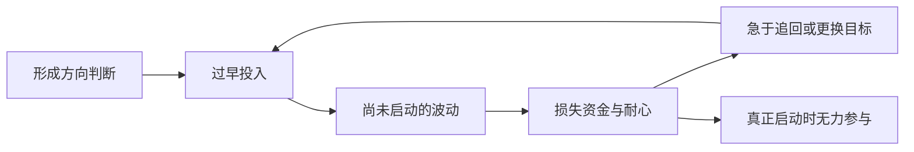

# 03 · 第二课：看对之后，怎样避免过早行动

> 学习顺序：**03 / 10**（本项目编号，含导论；作者课号另记）。
> [原视频：怎样炒股票才不会被套？](https://www.bilibili.com/video/BV17Q4y1N7v2) · 奇衡DK-CAPITAL · 2020-04-23 · 38:18  
> 作者在 00:29 左右明确称《股票作手操盘术》第二课。  
> [非逐字时间轴学习稿与核验记录](../transcripts/BV17Q4y1N7v2.md) · [系列学习地图](../)

上一课把研究、判断和行动分开，这一课进一步解释：**即使最终方向看对，进入过早、工具不合适、反复消耗本金与耐心，仍然可能无法获得那段收益。** 精读的重点是识别这些损耗从哪里开始。

2026-10-09 对照全片材料与原始课件回改；具体来源和校订程度见配套文字稿文末。涉及书中内容均为奇衡课堂转述；整理者的推导、练习和外部核验另行标明。标题“不被套”是课程问题，不是无亏损承诺。

## 一 “看对”没有自动解决路径问题

**课程依据：03:27—11:31。** 作者描述一种循环：很早形成方向判断，立刻入场；逆向波动后止损；再次看到希望又投入；反复之后资金或耐心不足，真正的行情到来时反而没有持仓。他随后批评只追求更精确的预测，而不研究执行为何失败。

这段可以用整理者的因果图帮助复习：

图描述的是课堂所讨论的一条失败路径，不是所有止损都会通向的结果。这里值得追问的不是“是否应取消止损”，而是前面的入场依据、风险预算和重复参与条件是否清楚。片中 31 分钟附近仍要求尊重自己预定的风险控制，不能把批评反复止损改写成鼓励死扛。

**整理者理解：** 一项预测包含方向，却未必包含时间、过程中最大不利变化、实际成交条件和退出安排。方向正确只覆盖了其中一部分。作者用较强的比例措辞强调执行，表达的是经验判断，不能把“做对占八成”当成精确统计。

**值得体会的点：** 亏损后最有吸引力的问题常是“怎样看得更准”，因为它让人觉得只差一条更聪明的消息。但若真正缺的是执行条件，增加预测信息可能并不修复问题。可以先把“哪条解释错了”与“哪一步行动没有依据”分别写下来，再决定需要补什么知识。

## 二 四类错误不是身份标签，而是四个尚未补上的条件

**课程依据：13:41—23:11；课件核验约 21:48。** 原油下跌案例是本课最集中的作者增量。奇衡将看起来逐渐更有经验的人放在同一张图中，说明会更多知识也可能在下一层约束上失败。

*原视频 [21:48](https://www.bilibili.com/video/BV17Q4y1N7v2/?t=1308)，原始课件帧。从左向右看四个圈画区域，再读各自的理由。图为课堂展示的连续／主力行情，不能当作一张始终不换月的合约，也不证明每类人的真实持仓与损失。*

| 课堂分类 | 决策所依赖的理由 | 忽略的条件 | 整理者提炼的检查问题 |
| --- | --- | --- | --- |
| 第一类 | 已经比前面便宜很多 | 跌幅没有证明下降过程结束；杠杆会改变承受结果 | 我说的“便宜”相对什么，是否只是旧价格？ |
| 第二类 | 市场已非常恐慌 | 情绪极端并不确定拐点；若需展期，还涉及期限结构 | 我是在识别情绪，还是已有行动条件？ |
| 第三类 | 出现了技术上的突破迹象 | 结构尚在形成，过早把局部反弹认作趋势转变 | 哪个参考位置已经形成，哪些还只是想象？ |
| 第四类 | 懂行情，也愿意等到极低价 | 长期判断不消除短期极端、杠杆和到期约束 | 所用工具是否允许我等到判断可能兑现？ |

表中检查问题为整理者自拟。课件用讽刺性群体称呼增强记忆，但学习时无需给自己或他人贴固定标签。同一个人可以在不同决策中重复不同错误。

**本段的推导：** 从价格出发，补上情绪，再补上技术和耐心，仍不足以排除工具本身的约束。知识不是按数量累加就能兑换安全；需要检查每一项知识到底解决了什么问题、还没有解决什么。

**读图时不要只找谁买得最低。** 第三类已经比第一类多等了一轮价格变化，第四类又多等了时间，仍可能分别败在结构未形成和持仓期限上。图上的左右位置不只是价格更低，也是在提出越来越具体的约束。对学习者更有用的动作，是说明自己增加了哪条证据，而非只说这次更谨慎。

“大家喊抄底所以不是底”也是作者的经验判断，不能升级为普遍反向指标。本课没有提供这类群体情绪信号的样本统计。

## 三 原油案例必须把方向、期限和交易工具拆开

**课程依据：19:15—23:11。** 作者反对把长期低价判断直接转成当下加杠杆参与，指出近月合约到期、换到更贵远月的负担，以及主力图已经换月造成的观察差异。

**外部核验：** CME 的教育材料说明，当远期价格高于近端价格时，期货曲线处于升水结构（contango），持续持有并展期的多头可能承受负的持有收益影响。这种影响与现货方向变化不是一回事。[CME：Hedging Portfolio with Commodity Currencies](https://www.cmegroup.com/education/featured-reports/hedging-portfolio-with-commodity-currencies)

**整理者解释：** 卖掉便宜的近月、换入更贵的远月，会改变持仓基础与后续收益路径；不应简单把两个不同到期合约的价格差，全部记成换仓瞬间相同头寸的额外已实现亏损。实际损益仍取决于旧仓盈亏、新合约走势、敞口和具体产品机制。连续图上的换月跳变也不是同一合约自然上涨。

另一个容易受后见之明影响的地方是负油价。EIA 记录，美国时间 2020年4月20日，纽约市场 WTI 近月期货出现负价格，主要涉及临近到期的五月合约，其他期限和油种并非统一转负。[EIA：Low liquidity and limited available storage pushed WTI crude oil futures prices below zero](https://www.eia.gov/TODAYINENERGY/detail.php?id=43495)

**时间边界：** 本视频页面发布在 4月23日，录制日期尚未确认。不能因为课中提醒极端风险，就称它是事前准确预言负油价；更不能把后来发生的事倒灌成当时课件已经展示过的证据。

**作者已在本课提出的杠杆纪律。** 22:40—23:11，他说自己不会因为原油更便宜便抄底，随后明确反对有杠杆的左侧参与，要求等待右侧。早版摘要只强调长期判断与到期，本轮补回这项明确限定。第 7 课对底仓与后续放大的讲解，是后来的展开，不能倒过来认为本课已经交代全部杠杆规则。

这一段的学习价值在于：即使看对长期方向，也要知道自己的持仓究竟是什么、何时到期、需要怎样续持。作者未核实的银行产品及额度叙述，不扩写为具体产品研究。

## 四 “右侧”开始有了参考位置，但还没有成为完整规则

**课程依据：17:25—19:15、22:40—23:11。** 作者不认可把一根阳线穿过下降趋势线，就立即称作右侧确认。他提到先观察第一波、甚至第二波反弹形成的高点；前面失败的反弹，也可能留下后续判断需要的参考位置。

这比上一课“等待确认”的原则更具体：确认要相对于已形成的结构说话，不能完全依据自己画出的未来路线。它**部分推进系列问题 Q5**。

不过，本课未统一规定反弹高点怎样确认、使用哪个时间周期、突破需维持多久、成交量是否必要，以及假突破如何退出。不能据此编写“突破前高即必买”的规则，也不能推断作者要求每次恰好等待两次反弹。

**整理者感悟：** 耐心不是单纯让时间过去，而是等待某项尚缺的信息出现。若能写出“现在缺少的是哪个观察结果”，等待才更容易复查；若只说“再等等”，它也可能成为回避决策的借口。

可做的纸面练习：在历史图上遮住右半部分，只标出当时已经形成的高低点与尚不确定的部分；以后再揭开图检验。这个练习用于检查是否偷用了未来信息，不证明某个画线方法有效。

## 五 个股题真正问的是：低价格能否补偿不确定的等待

**题面依据：23:11—24:09；解释：24:09—27:47。** 原图给出每股净利润 8 元；作者口述近期高点约 92、年线约 83、低点约 66、反弹至约 74。图没有可确认的公司名称，本文保留匿名，不采用弹幕识别。

*原视频 [23:39](https://www.bilibili.com/video/BV17Q4y1N7v2/?t=1419)，原始课件帧。图中文字给出每股净利润 8 元，价格图呈现此前高点、回落和反弹。年线约 83、当前约 74 等为口述近似，不能从图形猜公司身份。*

先停在题面思考：若愿意买入，理由是估值有吸引力、走势发生变化，还是仅仅比之前便宜？这三种理由需要不同证据。

可以先写三行：我已经知道什么、我还不知道什么、出现什么变化后愿意重新评价。尤其要把图上的价格、口述的近似数值和自己采用的估值假设分开。下面折叠的是作者解释与整理者验算，先作答再展开。这是整理者的复习安排。

::: details 展开作者解释与整理者验算

作者随后给出的选择是等待进一步走强，宁愿放弃 74 至 83 这一段。他关心的不只可能继续下跌，也包括长期在原区域波动所占用的资金。接着，他用 8 元利润、15 倍市盈率对应 120 元的假设，强调实现时间仍然重要。

**整理者验算与边界：** 8 × 15 = 120 只是条件计算，不证明 8 元利润能持续，也不证明 15 倍估值合理。若假设价格从 70 到 120 恰好用了十年，且忽略分红、成本与税，价格年化增幅约为：

\[
(120/70)^{1/10}-1 \approx 5.54\%
\]

这个算例不是课程收益预测。它支持“必须考虑时间”，但不能直接支持作者口述中与货币基金收益相近的泛化比较；该比较需要指定时期、产品及分红等条件。

**重要区分：** 等待更高价，可能是在交换更多关于走势的信息，而不必然是“越贵越安全”。价格经过 83 也不保证最终到 120；这里的路径论证只能说明达到更远价格通常先要越过中间区域，不能倒过来推成越过中间位置就必达目标。跳空与流动性还会使实际成交不同于图上连续路径。

这道题的精品学习结果应是能说清“等待什么、放弃什么、仍承担什么”，而非记住一个数字。

:::

## 六 用突破案例理解信息代价，而不是寻找万能买点

**课程依据：27:47—33:09；课件核验约 29:27。** 假设股票长期在 22—28 美元区间活动，当前 25，研究者认为可能到 50；课件举例等待其活跃、达到 30，再重新评估参与。数字是教学假设，不是某只股票的历史复盘。

**把假设分成三层。** 22—28 是过去的活动范围，25 是题设当下价格，50 是尚未发生的研究预期；30 则是作者用来说明等待活跃后的参与位置。它们不是同一类证据。若把预期的 50 当成已知终点，前面的等待自然显得多余；题目真正要练习的，是不借用这个尚未兑现的终点作决定。

**整理者理解：** 在 25 买入与在 30 评估，不是仅比较便宜和昂贵，而是比较两种信息状态以及相应代价：前者可能得到更低价格，也可能长期等待或失败；后者放弃部分潜在收益，仍承担假突破和买入后反转的风险。

作者批评箱体内反复操作，并用火鸡比喻经验突遭反例的情况。这个比喻有助于说明“重复发生不保证永远发生”，但不能据此证明所有区间交易都失败，更不能证明某段价格变化一定来自庄家设计。

本课出现“一进场就盈利”“上涨最安全”等强措辞。应将它们读为作者希望参与已启动行情的偏好，而非无风险定理。他在 31:06—31:24 附近仍要求承认买错及尊重预定风险控制；将这部分一并保留，才不会把课程标题变成保证。

## 七 低价、价值和周转，是三个不同的问题

**课程依据：33:09—37:15。** 作者明确区分相对内在价值的便宜与单纯低于历史高价，再用便利店畅销品和滞销品解释资金周转。这两步避免把整课误读成简单排斥估值研究。

**整理者理解：** 一项资产是否值得研究、价格行为是否支持当下参与、工具是否适合持有，是可以同时成立但需要分别回答的问题。趋势交易的选择不能替代价值判断，价值判断也不自动解决入场时机。

便利店比喻的启发在于周转：看起来采购便宜的货，如果长期卖不出去，同样会占用资源。但股票并不是商店库存，流动性、价格和收益机制不同；“畅销”也不会使购买者免于损失。

## 本课值得留下的感悟与练习

以下由整理者提出，均可回到课程片段核对。

| 触发位置 | 理解上的转变 | 一项可做的练习 | 不能推出什么 |
| --- | --- | --- | --- |
| 08:39—11:31 | 不再只问最后方向对不对，也问自己能否走过中间路径 | 将一项历史判断拆成方向、时间、入场、过程风险与退出五栏 | 不能因方向后来兑现就证明当初交易合理 |
| 19:15—23:11 | 愿意长期等待，还要有允许等待的工具和条件 | 只做资料研究：列清一个产品的标的、到期、杠杆、续持规则和未知项 | 不能把期货、基金、银行产品视为相同油价敞口 |
| 24:09—27:47 | 放弃一段利润，可以是为了等待信息，并非必然胆小 | 写下等待条件、机会代价和确认失败的可能，不用未来行情替自己辩护 | 不能证明等待总优于提前参与 |
| 33:09—37:15 | “比过去便宜”与“值得购买”之间还缺论证 | 对一项低价判断追问比较基准、收益来源与实现时间 | 不能仅凭下跌幅度认定有安全边际 |

最值得带到下一课的问题是：**如果偏好从一开始就表现良好的头寸，怎样处理正常波动、假突破和短暂浮亏？** 本课还没有把这些边界交代完整。

## 系列进展与新问题

- **Q5，确认如何定义：部分深化。** 本课引入反弹高点、重要阻力位和题例年线，仍缺统一信号及失效标准。
- **Q6，标普500分阶段建仓：有补充，未解决。** 13:03—13:41 作者称此前使用正金字塔，但各批仓位、底仓与后续期指条件仍未公开。
- **Q1，“最”字问题：仍未回答。** 不将右侧讨论擅自视为该悬念的正式解释。
- **盈利头寸与短暂浮亏的边界。** 37:15 后预告“不被套（2）”；现已核实为项目第 4 课，具体阶段、量价和时间条件留在后课，不倒填为本课已讲。
- **杠杆原则的出处补记。** 22:40—23:11 已明确反对有杠杆的左侧参与；第 7 课进一步展开，而非首次出现。

## 素材与修订记录

::: details 展开本轮回改与首版记录

2026-10-09：文字稿改为 12 步正文；精品笔记加入两张有时间定位的原始截图，将个股题与作者解释分开，补充四类错误的递进读法、假设价格的证据区别，以及本课已出现的杠杆限定。原有外部来源、年化算例与未解问题保留。全片材料已读、关键帧已核，尚未逐句人工校听。

首版已因明确的课堂练习与后课预告，采用先保留题面、再呈现解释的顺序，并记录预告与实际视频的对应关系；当时曾据此迭代 skill。本轮改进呈现与遗漏限定，无需另造分析模板。

:::

后续核验更新（2026-10-04）：原预告已确认为[《炒股不炒主升浪》](BV12A41147mW.md)。该片 04:14 左右明确说明第二章分两课，本片为第二讲；并对正常回撤补充阶段、量价与时间条件。上文待核状态保留当时记录，以此注记连接后续进展。

[返回精品笔记目录](./) · [上一课：从有观点到有资格行动](BV1Hp4y1y74h.md) · [系列学习地图](../)
