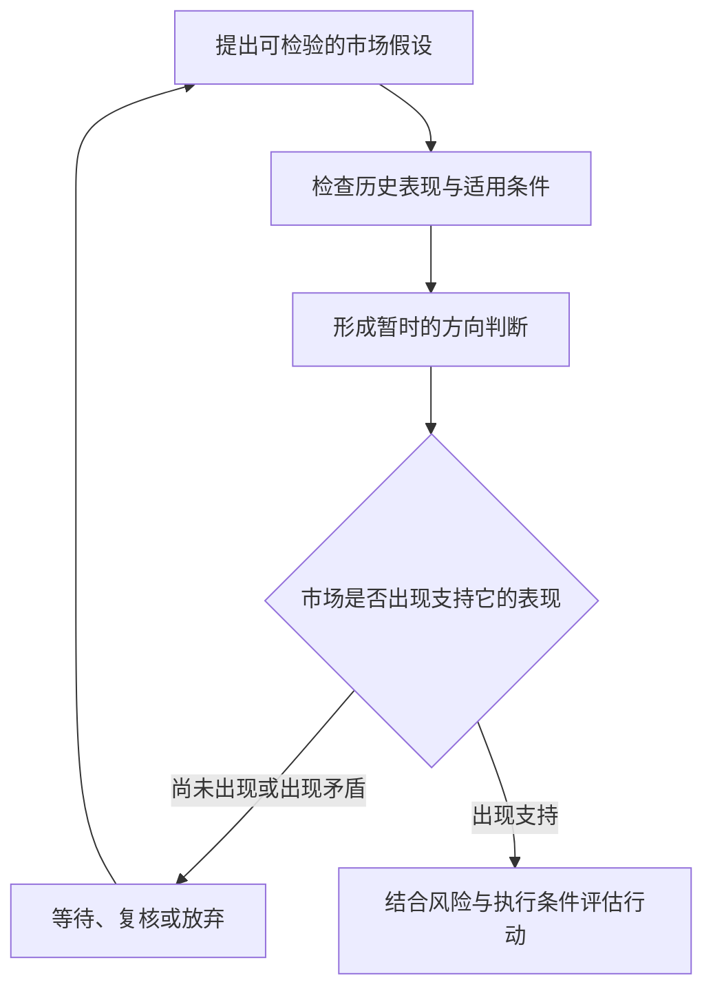

# 02 · 怎样炒股票：从有观点到有资格行动

> 学习顺序：**02 / 10**（本项目编号，含导论；作者课号另记）。
> [原视频：怎样炒股票](https://www.bilibili.com/video/BV1Hp4y1y74h) · 奇衡DK-CAPITAL · 2020-04-16 · 38:49  
> 正课开篇／《股票作手操盘术》第一章解读，视频正式课号未确认。  
> [时间轴学习稿及核验记录](../transcripts/BV1Hp4y1y74h.md) · [系列学习地图](../)

本课把导论中的“独立判断”向前推进了一步：**自己的观点要能接受检验，行动还要有另外的依据。** 学到一种解释，不代表当下就应当交易；市场没有支持自己的判断，也不必立刻跳到相反方向。

2026-10-09 对照全片材料与原始课件回改。作者课程、整理者理解与外部核验分别标示；历史案例保留 2020 年语境，素材与校订程度见配套文字稿文末。

## 本课真正改变的决策顺序

**课程依据：20:32—28:15、32:28—36:18。** 作者从研究方法讲到下单顺序，再用黄金例子保留“不交易”的选择。34:50 左右的课件明确呈现研究、检验、形成多空判断与观察确认之间的关系。

*原视频 [34:50](https://www.bilibili.com/video/BV1Hp4y1y74h/?t=2090)，原始课件帧。先读第三与第四项：有多空判断以后，还有观察和确认这一步。下方关于少量经验的批评，针对的是未经检验就推定胜率。*

下面是整理者依据课堂绘制的学习图，不是作者提供的完整交易系统：

最后一步的风险与执行评估是整理者补足的学习检查项；本课没有给出完整参数。图中“支持”也不等于证明未来必然按预期发展。

## 一 独立思考首先改变怎样请教别人

**课程依据：13:43—15:42。** 奇衡反对只问买什么、几成仓、要不要卖，要求提问者先说明自己的品种、时间范围、判断与计划。不同承受能力的人直接复制同一笔交易，结果可能完全不同。

这段的细致之处在于，他没有排斥请教。他仍愿意讨论一个已经成形的计划。老师提供的是对判断过程的反馈，学生仍承担决策责任。

**整理者理解：** 有用的提问可以写成：“我认为在某个时间范围内，条件 A 可能使 B 更容易发生；我依据的是这些资料；如果出现 C，我会重新考虑。这个推导哪里薄弱？”其中 C 是整理者加入的反证练习，本课未把它规定成统一模板。

**把提问改到可以讨论的程度。** 以下为整理者示例，不是作者原话：先写明研究的对象和时间范围，再陈述为何更倾向某个方向，随后列出准备观察的变化、已有计划和最不确定的一处。老师能够反馈的是理由是否充分、推导是否跳步；最后承担结果的仍是提问者。

这个练习有一个更深的作用：即使老师不在场，自己的判断也留下了可以复查的记录。事后才有可能知道，是解释错了、条件没出现，还是行动偏离了计划。单独保存一句买卖结论，通常无法回答这些问题。

这与“我就认定会上涨，谁说都不听”差别很大。独立性意味着能交代依据，不意味着拒绝外部信息。上一课强调不盲从，本课则展示了怎样让自主判断获得外部帮助。

## 二 心境管理从仓位与准备工作开始

**课程依据：15:42—18:17、32:28—35:41。** 作者把持仓后失眠、反复寻求确认与承受过多风险联系起来；同时在“心境管理”课件中，先列研究和检验交易结构，再讲行动。

**整理者理解：** 焦虑未必仅靠劝自己勇敢解决。若缺少研究依据，或者承担了无法接受的波动，反复给自己打气可能只是维持一项尚未想清楚的决定。学习可以先检查三个具体问题：为什么持有、哪些情况需要重估、风险规模是否与自己的条件相容。

这不意味着平静就证明交易正确。一个人可能对不了解的风险过度自信；“睡得着”只是主观压力信号，不能替代客观风险评估。作者所用的心理标签也不是医学诊断。

**可体会的点：** 纪律不是只有忍耐。承认某种规模暂时超出能力，并缩小任务，往往比坚持证明自己能扛更接近认真学习。这是整理者由本段引出的理解，不是对用户持仓状况的判断。

## 三 好想法要经历淘汰，不只是收集成功故事

**课程依据：20:32—23:39。** 作者以书中反复提出和检验想法的过程为引子，联系自己的策略研发经历。他强调查历史数据、排除不可靠方法，以及不要见过几次成功就投入实盘。

作者的关键转折是：一个想法被资料否定，并非毫无所得。至少知道有一条看似可行的路不应轻易拿本金去试。相反，见过几次成功就投入，亏损后再换一个未经检验的方法，可能一直在用实盘为相同的研究缺口付费。

**整理者理解：** 有价值的失败记录需要保留被否定的究竟是哪一项假设。一次没有兑现，未必足以判定永远无效；但每次失败都改条件，又会让检验失去意义。课程鼓励检验，具体样本数与否定标准仍需另外建立。

这个例子承担的教学作用是展示筛选过程，不能用作者自述的剩余策略成绩直接证明筛选方法有效。课程没有展示全部样本、规则与绩效记录，相关数量和收益仅属自述。

**整理者延展：** 一个观察要变得可检验，至少应写清 A 如何定义、B 在多久以内发生、哪些不成功案例也计入，以及何时不采用这一关系。否则每次结果不理想都可以改口说“这次不算”，经验就永远无法纠错。

还要分清三件事：观察到相关、提出可能机制、证明因果，彼此并不相等。课堂将这一过程联系到量化研究，有启发性，但没有完成严格的因果识别。

**外部核验：** SEC 的投资者教育材料明确区分历史实际业绩和假设回测业绩。因此“回测过”仍不能直接替代真实执行验证。[Investor.gov：Performance Claims](https://www.investor.gov/introduction-investing/general-resources/news-alerts/alerts-bulletins/investor-bulletins-47)

整理者建议的纸面练习是同时列成功与失败样本，并预留未参与规则调整的资料作后续检查。这是研究训练，不是本课已给出的回测方案。

## 四 方法的边界也是方法的一部分

**课程依据：23:39—25:17。** 学习者常只问在什么条件下能获利，作者追问另一半：什么条件下不应该使用这一方法。若省略后者，过去能赚钱的办法也可能把利润交回去。

*原视频 [24:18](https://www.bilibili.com/video/BV1Hp4y1y74h/?t=1458)，原始课件帧。两条方向要一起读。前半句寻找机会，后半句限定使用环境；本页没有提供可以直接识别环境的参数。*

**整理者理解：** “知道一个方法”至少包含两种知识：识别它适合的问题，以及识别问题已发生变化。会用一个工具，与能判断什么时候放下工具，是同一能力的两部分。

这也连接导论的波动结构问题，但本课没有给出辨认结构的数值定义。不能把“不参与不熟悉的环境”写成已经解决了如何识别环境。

**感悟与练习：** 读到一条很吸引人的经验时，除了写“我学会了什么”，再写“它还没有回答什么”。例如，本课要求等待确认，却没有指定确认周期、价格阈值和失效处理。把这些空白留下，能防止把原则误当完整系统。

## 五 市场确认不等于见涨就追

**课程依据：25:17—28:15、34:10—36:18。** 作者区分自己预想的变化与市场实际发生的变化。后者可能迟到，也可能根本不出现。黄金案例进一步说明：原本看空，而价格走高，他既不据原观点立即做空，也不因此立刻追多。

**整理者理解：** 主观判断与现实表现可以有三种关系，而不是只剩“买或卖”两个按钮：

| 情形 | 本课可以支持的学习结论 | 仍缺什么 |
| --- | --- | --- |
| 有研究判断，市场尚未支持 | 等待或继续检验有其位置 | 等多久、怎样判定失效 |
| 判断与市场出现一致迹象 | 进入行动评估，不等于保证获利 | 确认定义、仓位、止损与成本 |
| 走势反对原判断 | 承认矛盾，可以暂不参与 | 何时修改假设，何时建立反向依据 |

**黄金案例值得慢读的地方：** 35:53 后，作者先说走势与看空判断相反，随后又把话收窄为市场至少尚未证明自己正确。随后选择不参与，而不是急着补一个反向交易。这保留了判断强度的变化，也让本课的等待有了具体形态。

**整理者感悟：** 承认原判断暂时不能指导行动，未必需要马上证明另一种判断。可以先写下缺少什么证据，将这个空白留在记录里。这个动作改变的是如何对待不确定性；它本身不证明长期等待一定更好。

不能把“自己怎么看不重要”理解成无需思考。前半课已经花了大量时间要求研究；后半课限制的是观点对现实的支配权。**观点负责提出研究方向，不能单凭它命令市场照做。** 这是对课堂前后关系的整理。

同样，本课的“市场永远是对的”适合理解为接受当前价格与损益事实，不能据此证明价格在估值、信息或长期结果上永不出错。

## 六 两个历史案例，分别能教什么

### 券商传闻：练习核对解释与证据

**课程依据：28:15—32:28。** 作者展示整合传闻、聊天回应和价格变化，比较 A 股与 H 股反应。案例的可迁移部分是：面对消息，先问真实性、受益与付出分别属于谁，再检查市场如何反应。

但作者将“收购方下跌、被收购方上涨”说得很确定，又据此评价两地市场，笔记需要保留边界。**外部核验：** 并购研究中，收购方收益随交易对象、支付方式及治理条件等发生差异，并不存在所有收购方都必然下跌的普遍规则。[NBER：Globalization, Governance, and the Returns to Cross-Border Acquisitions](https://www.nber.org/papers/w16676)

因此，两家公司同涨不能单独证明传闻为假；一次 H 股表现符合作者解释，也不能证明 H 股始终更正确。课件公司名遮挡，本次不猜测身份，也没有据截图独立完成这一事件的公告核验。案例可用于研究思路，不能用于证明具体机构操纵或制造谣言。

### 标普500：学习行动过程，同时辨认尚未披露的规则

**课程依据：36:18—37:52。** 36:40 左右的课件明确是美国股市，并呈现 3月17日 的 ETF 底仓想法、后续期指与减仓记录；字幕中的“A股”不应采用。作者还结合模型、反弹和年线附近压力解释离场考虑。

*原视频 [36:40](https://www.bilibili.com/video/BV1Hp4y1y74h/?t=2200)，原始课件帧。左侧是作者选择展示的不同时点记录，右侧为价格图。先分开底仓、后续期指和减仓三个动作；图中的圈画不等于完整成交凭证。*

**读图顺序：** 先辨认左侧的 3 月 17 日底仓想法，再看后面的调整记录，最后才对照右侧走势。底仓承担什么角色、何时增加了新的依据，不能只由一张最终走势倒推。课件能够确认市场名称并展示叙述顺序，仍缺各批规模、执行价格和完整退出。

这段值得追问：在等待市场确认的框架中，底仓和后续期指分别满足了什么条件？本课未完整披露，不能替作者填上答案，也不能仅凭一句“开始建仓”认定他违背前述原则。不同阶段、工具与确认标准尚未交代清楚。

图示与自述展示的是作者选择呈现的历史决策，不能独立验证全部交易执行及收益。关于年线抛压的解释也不等于所有资产接近年线都会下跌。这里保留的是学习接口，不提供历史做法的当前复制指令。

## 值得反复体会的三次转变

以下均为整理者感悟，时间用于回到触发它的原片，而非作者原话。

| 触发片段 | 常见直觉 | 本课促成的转变 | 可以做的学习练习 |
| --- | --- | --- | --- |
| 13:43—15:42 | 找到高手，就能拿到答案 | 请教的质量取决于自己能否把问题想清楚 | 把“该怎么办”改写成有依据、有疑点的一页计划；不据此直接实盘 |
| 20:32—23:39 | 被否定的想法等于白费功夫 | 一次有证据的淘汰，也能减少以后重复犯错 | 留下被否定的原因与适用范围，避免把一次失败扩大为永远无效 |
| 35:41—36:18 | 判断错了，就应立刻站到另一边 | 承认不知道和暂不参与，也是一种完整决策 | 写清还缺哪条证据；不要把等待变成永不接受反证 |

这三次转变共同指向一种学习姿态：愿意做判断，也愿意让判断保持可修改。它既避免把责任交给权威，也避免把自我坚持误当能力。

## 复习题与后课接口

1. 为什么请教别人不一定违背独立思考？能否说出“请教计划”和“索取指令”的差别？（13:43—15:42）
2. 一个历史关系失败了，哪些信息能帮助区分规则有问题、环境有变化与普通随机结果？本课没有给出判别阈值，先列所需资料。（20:32—25:17）
3. 为什么黄金上涨既没有支持作者原先看空的行动，也没有自动构成追多的充分依据？（35:41—36:18）
4. 标普500案例的底仓与后续期指分别怎样确认？后课若补充，回到这里连接，不倒填作者本课没有说出的规则。（36:18—37:52）

上一课的“阻力最小路线中为何是‘最’字有问题”仍未明确解答。新增重点是**怎样定义确认，以及研究判断如何转换为不同阶段的仓位行动**。

## 素材与修订记录

::: details 展开本轮回改与首版记录

2026-10-09：配套文字稿改为 12 步正文；笔记补入三张带时间链接的原始课件帧，展开可讨论的提问、失败研究的价值、黄金案例的自我限定和标普500读图顺序。原有外部核验、概念边界及跨课问题保留，未将个人策略或收益自述提升为已验证结论。素材已读与关键帧核对，不等于逐句人工校听。

### 首版整理记录

教学从导论的人物故事，转向书中段落、研究经历、消息案例和流程课件。现有 skill 已允许按内容选择结构，无需另造固定模板。本次记录两个分析时应特别小心的点：强烈措辞要放回完整论证；看似一致的口述与截图，也可能在市场名称、行动规模上存在差别。后续仍逐课核验，不据两课概括作者全部体系。

:::

后课连接：[第二课](BV17Q4y1N7v2.md)进一步讨论过早行动、反弹参考位置与工具期限，并补充标普500正金字塔建仓的自述；确认和分阶段仓位仍未形成完整规则。

[返回精品笔记目录](./) · [上一课：从作手故事中学习判断力](BV1Hg4y187pU.md) · [系列学习地图](../)
